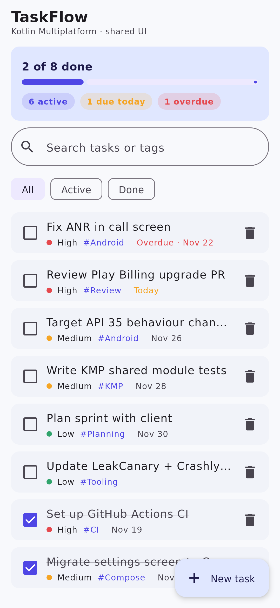
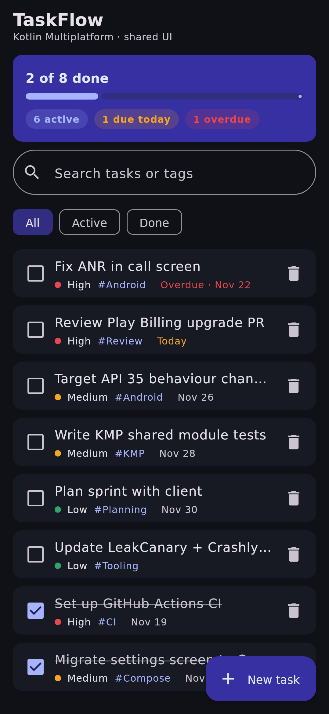
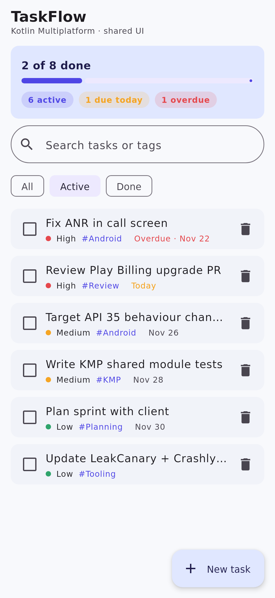
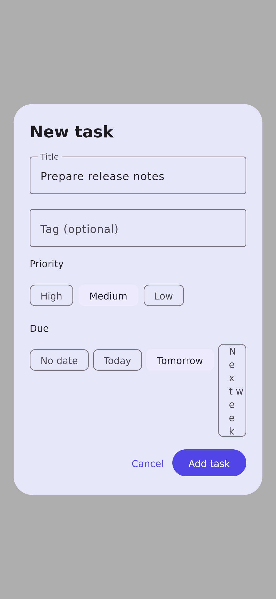
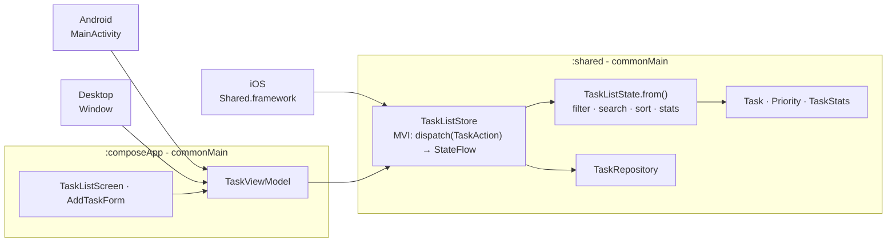

# TaskFlow · Kotlin Multiplatform

[](https://github.com/gayatripatel10091992/kmp-taskflow/actions/workflows/ci.yml)


-555)

A task manager whose **business logic is written once in Kotlin and shared by Android, Desktop and iOS**,
with a **Compose Multiplatform UI** shared by Android and Desktop.

The same app is also built in .NET MAUI ([maui-taskflow](https://github.com/gayatripatel10091992/maui-taskflow)), so you can compare the two approaches side by side.

## Screenshots

The shared UI is rendered headlessly on the JVM (Skia) at phone size by `ScreenshotTest`, and CI commits the images on every push.

| Task list | Dark mode | Active filter | New task |
|---|---|---|---|
|  |  |  |  |

## What's shared



| Piece | Where | Notes |
|---|---|---|
| Models, filtering, sorting, stats | `shared/commonMain` | Pure functions, tested on JVM, Android and **iOS simulator** |
| State holder (MVI) | `shared/commonMain` | `TaskListStore` takes any `CoroutineScope`, so each platform plugs in its own lifecycle |
| Repository | `shared/commonMain` | In-memory `StateFlow` implementation behind an interface; swap for SQLDelight or Room KMP |
| ViewModel | `composeApp/commonMain` | JetBrains multiplatform `ViewModel` (survives rotation on Android) |
| UI | `composeApp/commonMain` | Material 3, stateless screens driven by `TaskListState` |
| Platform code | `androidMain` / `desktopMain` | Only the entry point and one `expect fun platformName()` |

## Run it

```bash
./gradlew :composeApp:installDebug     # Android
./gradlew :composeApp:run              # Desktop
./gradlew :shared:allTests             # shared tests (iOS tests need macOS)
./gradlew :composeApp:desktopTest      # regenerate screenshots
```

## CI

- **Linux job:** shared tests (JVM + Android), Android APK, desktop distributable, screenshots committed to `docs/screenshots`.
- **macOS job:** the same shared tests on the **iOS simulator**, and links `Shared.framework`.

## Next steps

- SwiftUI host app consuming `Shared.framework`
- SQLDelight persistence
- Compose Multiplatform iOS target for the UI

## License

MIT © Gayatri Patel
